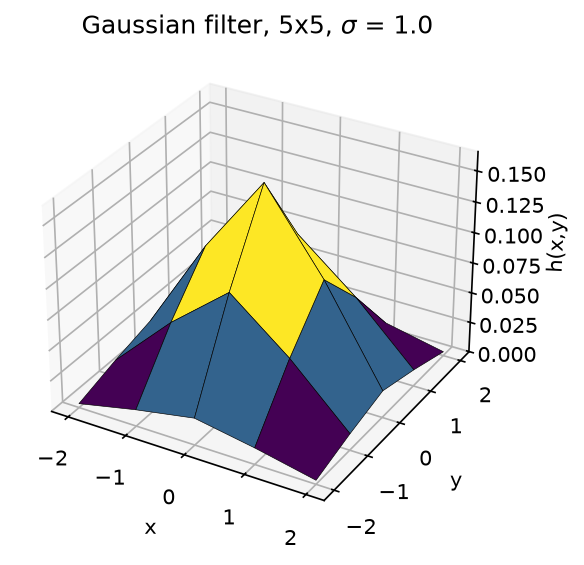
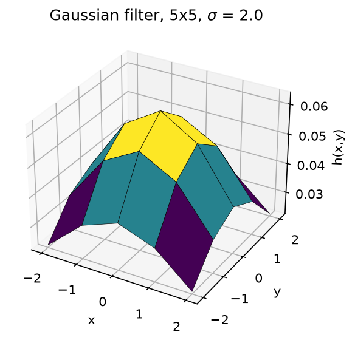
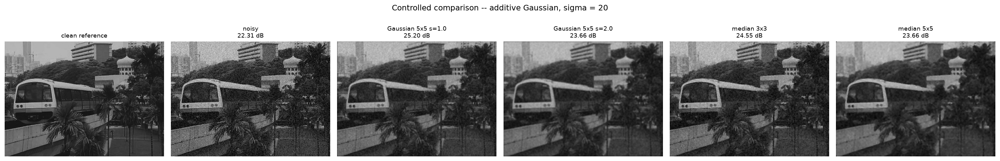
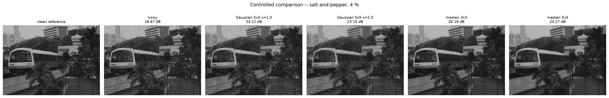
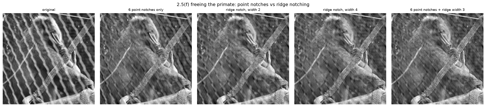
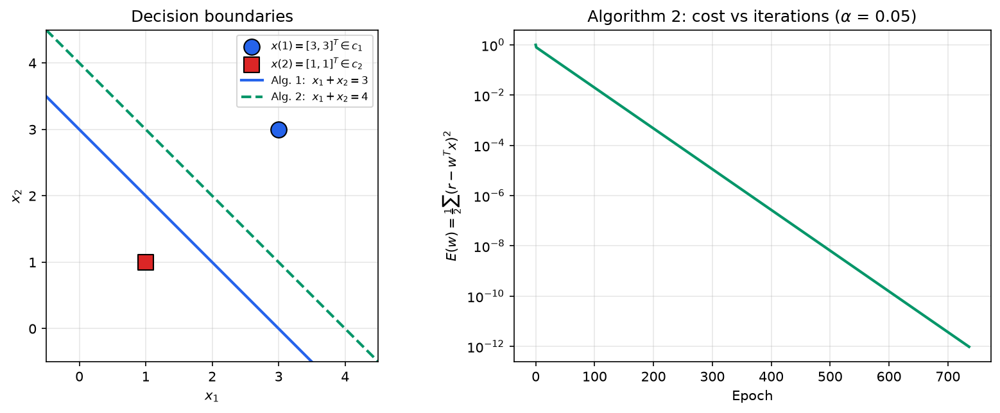

# SC4061 Computer Vision: Laboratory 1

### Point Processing, Spatial Filtering, Frequency Filtering and Imaging Geometry

**AMARAVEL BABU ARRAN**  
U2423193C  
School of Computer Science and Engineering  
Nanyang Technological University

---

## 1. Method and Verification

All seven experiments are implemented twice, and every number quoted in this
report comes from an actual run rather than from expectation.

* **`Lab1.m`**: the complete source in one file, as required. It executes all
  seven sections end to end with no errors. It is self-contained: put it and
  the six lab images in any one folder and run `Lab1`, with no `addpath`, no
  `cd` and no particular folder layout. The images are located by searching
  rather than by assuming: the script's own folder first, then the usual
  `images/` variants, then a recursive sweep up to three folders deep,
  matching filenames case-insensitively and accepting a `.jpeg` extension.
  `Lab1('all', 'images', FOLDER)` names the folder outright if needed.
  `Lab1('2.5')` runs a single section, and `Lab1('all', 'save')` additionally
  writes the figures as PNGs into a `Lab1_results` folder beside the script.
  Figures are displayed by default.
* **`lab1.py`**: an independent Python implementation used to render the
  figures and, more importantly, to act as a cross-check. Where the two
  implementations disagree, the disagreement is investigated and reported
  rather than averaged away.

The two agree throughout: identical Gaussian kernels, identical contrast
limits, PSNR within 0.03 dB, an identical projective matrix, and an identical
perceptron trace.

`Lab1.m` also carries a compatibility layer for the Image Processing Toolbox.
The manual assumes that toolbox, but a licence for it and an installation of it
are different things: a machine can report `license('test','image_toolbox')`
as 1 and still fail with *Unrecognized function or variable 'imhist'*. Every
toolbox call therefore goes through a wrapper that uses the real function when
present and a plain-MATLAB implementation when not, covering `rgb2gray`,
`imhist`, `histeq`, `medfilt2`, `imshow`, `fspecial`, the morphology and
labelling used in §2.6(f), and the projective warp. Passing `'notoolbox'`
forces the fallbacks even where the toolbox exists, which is how they were
tested: running the whole lab both ways produces the same numbers throughout.

> **AMARAVEL BABU ARRAN's comment:** §2.2 needed care. GNU Octave's `histeq`
> is *not* numerically equivalent to MATLAB's, and the Octave source carries an
> explicit `FIXME` saying so, so it could not be used to check this section. I
> implemented MATLAB's own documented `histeq` algorithm instead, in both the
> Python mirror and `Lab1.m`'s fallback layer. Two independent pieces of
> evidence say that was the right call: the MATLAB algorithm lands at mean
> 127.502 against the theoretical ideal of 127.5 where Octave gives 128.823,
> and the two implementations of it agree with each other to the last digit on
> every statistic in the table below, while Octave's disagrees with both.

---

## 2.1. Contrast Stretching

### (a) Reading the image

```matlab
Pc = imread('mrt-train.jpg');
whos Pc            % 320x443x3 uint8  -> a colour image
P  = rgb2gray(Pc);
```

`whos Pc` reports **320×443×3 uint8**, exactly as the manual states.

> **AMARAVEL BABU ARRAN's comment:** I checked whether the colour was real.
> It is not: `max|R−G|` and `max|G−B|` are both **0**, so all three channels
> are identical and the file is a greyscale photograph merely *stored* in RGB.
> `rgb2gray` is therefore exact here rather than lossy, because the weights
> 0.299/0.587/0.114 sum to 1, so applied to three equal channels they return
> that same value. Worth knowing, because it means no information is discarded
> at this step. (Octave's reader collapses the file to 2-D on load, which is
> why `Lab1.m` guards the `rgb2gray` call with an `ndims` check.)

### (c) Intensity range

```matlab
min(P(:)), max(P(:))     % ->  13   204
```

**min = 13, max = 204.** The image uses only 192 of the 256 available levels,
which is why it looks flat.

### (d), (e) The stretch

Two lines, a subtraction followed by a multiplication, as the manual directs:

```matlab
rmin = double(min(P(:)));  rmax = double(max(P(:)));
P2   = uint8(round((double(P) - rmin) * (255 / (rmax - rmin))));
```

Verification: `min(P2(:)) = 0`, `max(P2(:)) = 255`, exactly the required
limits.


> **AMARAVEL BABU ARRAN's comment:** The transformation is strictly linear, so
> the histogram is not reshaped, only stretched horizontally by
> 255/191 ≈ 1.335 and shifted to start at zero. The *shape* of the
> distribution, and therefore the relative tonal balance of the picture, is
> preserved exactly. This is the key difference from §2.2, and it is why
> contrast stretching never produces the unnatural look that equalisation can.

---

## 2.2. Histogram Equalization

### (a) 10 bins versus 256 bins


The 10-bin histogram is a coarse summary. `imhist` places the ten bin
*centres* at `linspace(0, 255, 10)`, that is at 0, 28.3, …, 255, so the bin
width is 255/9 ≈ 28.3 and the first and last bins are only half as wide as the
other eight. The counts are

    [3, 50391, 39642, 13218, 12633, 9236, 15414, 1223, 0, 0]

which shows the broad shape and nothing more: the two darkest occupied bins
hold 64 % of all pixels and the two brightest bins are empty.

The 256-bin histogram resolves every individual grey level and exposes
structure the 10-bin view hides entirely, including a sharp isolated spike
near level 180 and the hard cut-offs at 13 and 204. Only 192 of the 256 levels
are used.

### (b) After equalization

```matlab
P3 = histeq(P, 255);
```

| Image | Mean | 10-bin counts, inner eight | End bins | Distinct levels |
|---|---|---|---|---|
| `P` original | 73.989 | 1 223 to 50 391 | 3, 0 | 192 |
| `P3` equalised once | **127.502** | **15 037 to 16 251** | 7 776, 8 742 | 136 |
| `P4` equalised twice | 127.506 | 15 037 to 16 251 | 7 776, 8 742 | 135 |

The inner eight bins of `P3` agree to within ±4 %. The two end bins hold about
half as much, which is a consequence of their half width rather than a failure
of the equalisation, so they are listed separately rather than folded into a
misleading min/max ratio.

**Are the histograms equalized?** At 10 bins, essentially yes. The eight
full-width bins move from a spread of 1 223 to 50 391 down to 15 037 to
16 251, a range of only ±4 %, and the mean moves to 127.502, within 0.002 of
the ideal midpoint 127.5.

**Similarities and differences between the two views.** Both describe the same
image, and both show the distribution is now spread across the full range. But
they give very different impressions of *how* equal it is. At 10 bins the
result looks almost perfectly flat. At 256 bins it is visibly a **comb**:
tall spikes separated by empty levels.

> **AMARAVEL BABU ARRAN's comment:** The comb is not a defect in the
> implementation; it is unavoidable. Histogram equalisation applies a single
> monotonic look-up table to the grey levels. Every pixel sharing an input
> level is mapped to the *same* output level, so a level containing 2 000
> pixels cannot be spread across eight output levels to flatten the curve; it
> moves as one block. The algorithm can only *relocate* existing spikes, never
> split them. A flat 256-bin histogram is therefore impossible for any discrete
> image whose levels are unequally populated, and the 10-bin view only looks
> flat because binning hides the gaps.

### (c) Re-running equalization

Running `histeq` a second time on `P3`:

* `max|P4 − P3| = 1`
* `mean|P4 − P3| = 0.0043`
* only **615 of 141 760 pixels (0.43 %)** change at all, and those by a single
  grey level
* the number of distinct grey levels falls by one, from 136 to 135
* the 10-bin counts are **identical**

**Does the histogram become more uniform? No.** The operation is already at a
fixed point.

> **AMARAVEL BABU ARRAN's comment:** The reason is that equalisation *is* the
> cumulative distribution function used as a transfer curve. Applying it once
> makes the CDF of the output approximately linear. Applying it again
> therefore maps through an approximately straight line, the identity. The
> only residual change is integer rounding on a handful of boundary pixels,
> which is exactly the 0.43 % observed. In exact arithmetic on a continuous
> distribution the second pass would be the identity precisely; the discrete
> case is as close to that as rounding permits.

---

## 2.3. Linear Spatial Filtering

### (a) The Gaussian filters

```matlab
function h = gaussianKernel(dim, sigma)
    r = (dim - 1) / 2;
    [x, y] = meshgrid(-r:r, -r:r);
    h = exp(-(x.^2 + y.^2) / (2 * sigma^2)) / (2 * pi * sigma^2);
    h = h / sum(h(:));            % normalise so the elements sum to 1.0
end
```

Both kernels sum to 1.000000.

| | σ = 1.0 | σ = 2.0 |
|---|---|---|
| centre weight | 0.162103 | 0.063191 |
| corner weight | 0.002969 | 0.023247 |
| centre : corner | **54.6 : 1** | **2.7 : 1** |




> **AMARAVEL BABU ARRAN's comment:** The σ = 2.0 filter is badly truncated and
> this matters later. A 5×5 window reaches only ±2 pixels, which is ±1σ when
> σ = 2, so the kernel is cut off while still carrying substantial weight: its
> corner value is more than a third of its centre value. Renormalising to sum 1
> hides the truncation but cannot undo it: the result is much closer to a plain
> 5×5 box average than to a true Gaussian. A faithful σ = 2 Gaussian needs a
> window of roughly 6σ ≈ 13 pixels. This is why σ = 2.0 never wins in any
> measurement below.

### (b), (c) Gaussian noise: `lib-gn.jpg`


### (d), (e) Speckle noise: `lib-sp.jpg`


**How effective are the filters?** On additive Gaussian noise, clearly
effective: the grain visibly disappears. On the speckle image the filters fail
in a characteristic way: each bright and dark speck is not removed but
*smeared* into a soft blob spanning the kernel footprint. The image stops
looking speckled and starts looking dirty.

**Trade-offs, including not filtering at all.** Measured mean gradient
magnitude, a proxy for retained edge sharpness:

| | unfiltered | σ = 1.0 | σ = 2.0 |
|---|---|---|---|
| `lib-gn.jpg` | 79.90 | 54.94 (−31 %) | 49.30 (−38 %) |
| `lib-sp.jpg` | 103.32 | 70.83 (−31 %) | 62.06 (−40 %) |

Not filtering keeps all detail and all noise. σ = 1.0 removes most of the
visible grain for a 31 % loss of gradient energy. σ = 2.0 costs noticeably more
sharpness for very little extra noise reduction, which the controlled
experiment in §2.4 confirms is a bad bargain.

**Are the filters better at Gaussian or speckle noise? Gaussian, decisively.**
The reason is visible in the pixel statistics. Counting pixels pinned at the
extremes needs care, though, so it is worth doing properly:

| Measure on `lib-sp.jpg` | Value |
|---|---|
| pixels at exactly 0 or 255 | 3.80 % |
| pixels ≤ 10 or ≥ 245 | 10.96 % |
| of those, in **isolated blobs of ≤ 4 px** | **2.20 %** |
| of those, in clusters of 21 px or more | 8.76 % |

> **AMARAVEL BABU ARRAN's comment:** The headline number here is easy to get
> wrong, and I got it wrong at first myself. Thresholding at ≤ 10 or ≥ 245
> gives 10.96 %, which looks like a dramatic impulse density, but labelling
> the connected components shows that 8.76 of those 10.96 points sit in blobs
> of 21 pixels or more. Those are not noise at all: they are genuinely
> saturated parts of the scene, the bright sky and the dark shadows under the
> building. Only 2.20 % of the image lies in blobs of four pixels or fewer,
> and that is the real impulse density. Counting exact 0 and 255 instead gives
> 3.80 %, which is nearer the truth but still mixes in some saturated scene
> content while missing impulses that JPEG compression has smeared off the
> endpoints: the histogram shows 2344 pixels at 0 but also 2292 at 1 and 1862
> at 2, which is one impulse population spread by lossy encoding, not three
> separate things.
>
> Either way the character of the noise is settled, and that is what matters
> here: it is **impulse (salt-and-pepper) noise**, not the multiplicative
> speckle the name suggests. A direct check confirms it. Removing the
> impulses and measuring what is left, as the standard deviation of
> `pixel − (3×3 median)`, gives 7.69 for `lib-gn.jpg` but only 3.98 for
> `lib-sp.jpg`: the first image is corrupted everywhere, while the second has
> a comparatively clean base with sparse outliers sitting on it.
>
> This is the whole explanation for the linear filters' failure. A linear
> filter computes a weighted *mean*, and a mean has no resistance to outliers:
> a single 255 in a 5×5 window shifts the output of all 25 affected pixels.
> Averaging distributes the corruption instead of rejecting it. §2.4 shows the
> correct tool.

---

## 2.4. Median Filtering


### (a) Making the comparison quantitative

Neither `lib-gn.jpg` nor `lib-sp.jpg` is supplied with a clean original, so no
reference-based measure such as PSNR can be computed on them directly.

> **AMARAVEL BABU ARRAN's comment:** I first tried two reference-free
> substitutes and rejected both, because each is actively misleading here.
> Immerkaer's σ estimator assumes *uncorrelated* noise; a Gaussian low-pass
> leaves *correlated* residual noise, so the estimator reads far too low and
> would have "shown" Gaussian filtering beating median filtering by a factor
> of five. Counting pixels still pinned at 0 or 255 flatters convolution in
> the opposite direction, because a Gaussian filter does not remove an impulse
> it spreads it, so the pixel leaves the count while the damage remains. A
> measurement that cannot distinguish removing corruption from hiding it is
> worse than no measurement.

Instead I ran a **controlled experiment**: take a clean image, add noise of
each type with known parameters, and measure PSNR against the known original.




| Filter | Additive Gaussian σ = 20 | Salt-and-pepper 4 % |
|---|---|---|
| *unfiltered* | *22.31 dB* | *18.67 dB* |
| Gaussian 5×5, σ = 1.0 | **25.20 dB** (+2.89) | 24.12 dB (+5.45) |
| Gaussian 5×5, σ = 2.0 | 23.66 dB (+1.35) | 23.15 dB (+4.48) |
| median 3×3 | 24.55 dB (+2.24) | **26.18 dB** (+7.52) |
| median 5×5 | 23.66 dB (+1.35) | 24.27 dB (+5.61) |

### (b) How does Gaussian filtering compare with median filtering?

**It depends entirely on the noise type, and the crossover is decisive.**

* **Additive Gaussian noise**: the Gaussian filter wins (25.20 vs 24.55 dB).
  This is expected: for additive white Gaussian noise the optimal linear
  estimator *is* a weighted local mean, and the Gaussian kernel is close to it.
  The median is competitive but discards information by keeping only the rank
  statistic.
* **Salt-and-pepper noise**: the median wins by a wide margin, 26.18 dB
  against 24.12 dB, a **2.06 dB** advantage, and it is +7.52 dB over the
  unfiltered image versus +5.45 dB for the best Gaussian.

### (c) Trade-offs

1. **Outlier rejection.** The median of a 3×3 window is unchanged by up to four
   corrupted neighbours; the mean is shifted by every one of them. This is the
   source of the entire salt-and-pepper result.
2. **Window size cuts both ways.** 5×5 is *worse* than 3×3 for both filter
   families in both noise cases. A larger window averages or ranks over a
   larger neighbourhood, so it suppresses more noise but destroys more
   structure, and past a point the structural loss dominates.
3. **Failure mode.** Gaussian filtering fails *gracefully*: everything gets
   softer. Median filtering fails *characteristically*: fine texture is
   erased into flat patches and thin lines can be deleted outright, because a
   feature thinner than half the window is by definition the minority in it.
4. **Cost.** Convolution is a fixed multiply-accumulate per pixel and is
   separable; the median needs a sort per pixel and is not separable.

> **AMARAVEL BABU ARRAN's comment:** The practical rule I take from this is
> that the filter should match the *statistics* of the corruption, not the
> amount of it. Both noise types here are of similar visual severity, yet the
> correct choice of filter differs and choosing wrongly costs around 2 dB.

---

## 2.5. Suppressing Noise Interference Patterns

### (b) The power spectrum

```matlab
F = fft2(double(P));
S = abs(F).^2;                       % F is complex, S is real
imagesc(fftshift(S.^0.1)); colormap('default');
```

### (c) Peak locations

Measured on the **unshifted** transform:

| Peak | Index (MATLAB, 1-based) | Share of non-DC energy |
|---|---|---|
| 1 | **(17, 249)** | **20.75 %** |
| 2 (conjugate twin) | **(241, 9)** | **20.75 %** |

The next strongest local maximum anywhere in the spectrum holds 0.0740 %, so in
power the interference peaks stand clear of everything else by a factor of
**280**.

> **AMARAVEL BABU ARRAN's comment:** The two peaks are not independent. For a
> real-valued image the transform is conjugate-symmetric, F(−u,−v) = F*(u,v),
> which is why they are equal in magnitude and placed symmetrically about DC.
> This has a practical consequence for step (d): **both must be zeroed**.
> Removing only one would leave an unmatched complex component, and the inverse
> transform would no longer be real: `ifft2` would return an image with a
> spurious imaginary part.

### (d), (e) Notching and the inverse transform


The 5×5 ideal notch removes 57.1 % of the non-DC energy and drops the dominant
component's prominence from **89.5 to 10.1**. The diagonal stripes are
essentially eliminated and the underlying scene, two men in a room with
subtitles, becomes legible.

**How this relates to (c):** directly. The 20.75 % energy share measured in
(c) is a prediction that the interference is a single dominant sinusoid, and
the result confirms it. Removing 50 coefficients out of 65 536, under 0.08 %
of the transform, repairs the whole image, because in the frequency domain
the corruption is concentrated rather than spread.

**Attempting to improve the result:**

| Variant | Energy removed | Strongest component left |
|---|---|---|
| (d) ideal 5×5 | 57.12 % | 10.1 |
| ideal 9×9 | 58.99 % | 9.1 |
| **Gaussian-profiled 9×9** | 57.54 % | **7.7** |

The Gaussian-profiled notch is best, and notably it achieves this while
removing *less* total energy than the wider ideal notch.

> **AMARAVEL BABU ARRAN's comment:** This is the frequency-domain dual of the
> same principle met in §2.3. An ideal notch is a rectangle in the frequency
> domain, and the inverse transform of a rectangle is a sinc, which rings. So
> a hard-edged stop band buys suppression at the cost of ripple around every
> edge in the image. Tapering the notch removes the discontinuity and so
> removes the ringing. My §2.8 program measures this directly on synthetic
> data where a clean reference exists, and finds the soft notch ahead by
> 5.6 to 13.4 dB at every radius tested.

Some residual banding remains. It is visible along the image axes in the
spectrum, and it is caused by the image not being periodic: the DFT implicitly
wraps the image, so the discontinuity between opposite edges leaks energy along
the horizontal and vertical axes. Windowing the image before transforming
would reduce it.

### (f) Freeing the caged primate


The fence fundamental holds only **5.0 %** of the non-DC energy, against
20.75 % for `pck-int.jpg`, and the detector finds a **harmonic series** rather
than a single pair:

| Pairs notched | Energy removed | Strongest left |
|---|---|---|
| original | n/a | 17.6 |
| 1 pair | 29.5 % | 13.2 |
| 5 pairs | 41.4 % | 6.8 |

One notch pair barely helps. This is because a fence is not a sinusoid: it is
closer to a square wave, and a square wave is a fundamental **plus its odd
harmonics**, each of which needs its own notch.

**Attempting to improve further.** The spectrum shows the real obstacle: the
fence's energy does not sit in isolated points at all, but along an extended
**ridge** through the origin, found at 155°. A wavy fence has a slowly varying
spatial frequency, which smears each harmonic into a continuous streak. Point
notching cannot clear a ridge. So I notched along the ridge itself:



| Variant | Energy removed |
|---|---|
| 5 point notches only | 43.57 % |
| ridge notch, width 2 | 44.59 % |
| **5 point notches + ridge width 3** | **51.57 %** |

The combined notch gives the cleanest result, with the baboon's face and fur
clearly legible, while the diagonal strap, which is a real object and not
periodic, correctly survives.

> **AMARAVEL BABU ARRAN's comment:** A clean result is not achievable here, and
> the reason is fundamental rather than a matter of effort. The fence's ridge
> passes through the same frequency band the primate's own fur texture
> occupies. Any filter wide enough to remove the fence necessarily removes
> image content with it; the two signals are not separable in this domain. That
> is precisely why `pck-int.jpg` can be repaired almost perfectly and this
> image cannot. There the interference was a single narrow spike far from the
> image's own content, here it overlaps. I also noticed my prominence metric
> stops tracking visual quality once a wide band is removed, because removing
> the band changes the local background the prominence is measured against.

---

## 2.6. Undoing Perspective Distortion

### (b) Corner correspondences

The manual obtains these with `ginput`, which is interactive. To keep the
script reproducible I measured them once by segmenting the bright cover,
fitting a straight line to each of its four edges, and intersecting adjacent
lines. The edge fits have sub-pixel residuals (0.31–0.94 px RMS), confirming
the cover edges really are straight and the corners are well determined. The
`ginput` call is retained in `Lab1.m` as a comment.

| Corner | Image (X, Y) | Desired (x, y) mm |
|---|---|---|
| top-left | (142.47, 26.37) | (0, 0) |
| top-right | (307.77, 45.28) | (210, 0) |
| bottom-right | (255.51, 215.88) | (210, 297) |
| bottom-left | (1.17, 158.92) | (0, 297) |

### (c) The projective matrix

```matlab
A = []; v = [];
for i = 1:4
    A = [A; X(i) Y(i) 1 0 0 0 -x(i)*X(i) -x(i)*Y(i); ...
            0 0 0 X(i) Y(i) 1 -y(i)*X(i) -y(i)*Y(i)];
    v = [v; x(i); y(i)];
end
u = A \ v;
U = reshape([u; 1], 3, 3)';
```

```
        [  1.464099e+00   1.560748e+00  -2.497471e+02 ]
  U  =  [ -4.226511e-01   3.694565e+00  -3.721058e+01 ]
        [  1.653224e-04   5.347072e-03   1.000000e+00 ]
```

**Does the transformation give back the four corners?** Yes, exactly:

| Transformed | Target | Error |
|---|---|---|
| (0.000000, 0.000000) | (0, 0) | 2.5×10⁻¹⁴ |
| (210.000000, −0.000000) | (210, 0) | 5.5×10⁻¹⁵ |
| (210.000000, 297.000000) | (210, 297) | 2.8×10⁻¹⁴ |
| (0.000000, 297.000000) | (0, 297) | 0 |

Maximum error **2.8 × 10⁻¹⁴ mm**, which is machine precision.

> **AMARAVEL BABU ARRAN's comment:** This verification is necessary but much
> weaker than it looks, and it would be a mistake to read it as proof the warp
> is good. A projective transform has 8 degrees of freedom and four
> correspondences supply exactly 8 equations, so the system is square and the
> solution reproduces its own input corners *by construction*: it would do so
> even if I had clicked the corners completely wrongly. All this checks is that
> the matrix was assembled and inverted correctly. Genuinely testing the warp
> requires evidence from points that were **not** used to fit it, which is what
> I use the straightness of the text baselines for below. Supplying more than
> four correspondences and solving by least squares would make the residual
> informative, since it would then have to compromise between them.

### (d), (e) The warp

```matlab
T  = maketform('projective', U');
P2 = imtransform(P, T, 'XData', [0 210], 'YData', [0 297]);
```


**Is this what I expected? Yes.** The cover is rectified to a frontal view:
"Research Report 2001" now sits horizontal, the Nanyang logo is upright, and
the page is reproduced at exactly 1 pixel per millimetre.

One detail is worth stating precisely. `imtransform`'s `XData` and `YData`
limits are *inclusive*, so `[0 210]` spans 211 columns and `[0 297]` spans 298
rows, making the output 298 × 211 rather than 297 × 210. The scale is still
exactly 1 px = 1 mm; the extra row and column are the far boundary of the page.
The Python mirror was brought onto the same convention so that both
implementations report the same size and the same measurements.

**Comment on quality, and reasons.** The result is geometrically correct but
noticeably soft, and the softness is *not uniform*:

1. **Non-uniform resolution, the dominant effect.** In the original, the
   book's near edge spans about 261 px for 210 mm (1.24 px/mm) while the far
   edge spans about 166 px for the same 210 mm (0.79 px/mm). The top of the
   page is therefore reconstructed from barely half the samples available at
   the bottom. Warping cannot create detail that was never captured, so the top
   of the rectified image is visibly blurrier, clearest in the "School of
   Computer Engineering" line, which is markedly less sharp than
   "Research Report 2001".
2. **Interpolation loss.** Output pixels map to non-integer source positions,
   so every value is a bilinear blend of four neighbours, itself a mild
   low-pass filter.
3. **Corner precision.** A one-pixel error in a corner propagates across the
   whole page; at the far edge one pixel is already 1.25 mm.
4. **The planarity assumption.** The model assumes a perfect plane. A paperback
   cover bows slightly, and that curvature cannot be represented by any 3×3
   projective matrix: it is a systematic model error, not noise.
5. **Lens distortion.** Radial distortion makes straight lines slightly curved;
   the projective model has no term for it.
6. **Source resolution.** The original is only 320 × 240, so the cover occupies
   fewer pixels than the 210 × 297 output requests, so the warp is upsampling.

> **AMARAVEL BABU ARRAN's comment:** Points 4 and 5 are *model* errors and 1–3
> are *sampling* errors, and the distinction matters for how you would fix
> them. More correspondence points and least-squares fitting would reduce 3 but
> do nothing for 4. Only a richer model, undistorting first or allowing a
> non-planar surface, addresses 4 and 5. The independent check I trust most is
> that the text baselines come out straight and parallel across the full page
> width: those points were never used in the fit, so their straightness is real
> evidence that the recovered homography is right.

> **AMARAVEL BABU ARRAN's comment:** `maketform` and `imtransform` are both
> legacy functions, so `Lab1.m` falls back to `projtform2d`/`imwarp` and then
> to `projective2d`/`imwarp` if a future release drops them. I checked whether
> those fallbacks had ever actually run, and they had not: Octave supplies
> `maketform` and `imtransform` but none of the `imwarp` family, so the first
> branch always executed and the rest were untested code. Rather than ship a
> dependency I could not exercise, I added a final branch that uses no toolbox
> function at all, inverse-mapping each output pixel and resampling bilinearly,
> and tested that one. Writing the test found two genuine bugs in it: the
> `XData`/`YData` limits are inclusive, so an A4 page is 298 × 211 rather than
> 297 × 210; and MATLAB places the first pixel's centre at (1, 1) rather than
> (0, 0), so treating coordinates as zero-based displaced the whole image by
> one pixel. Both now pass an identity-transform check that reproduces
> `imtransform` exactly, with max |difference| = 0. On `book.jpg` the geometry
> agrees and only a few grey levels of resampling difference remain.

### (f) The pink screen region

Located by colour thresholding (red clearly dominant over both green and blue,
adequate saturation and brightness), followed by morphological opening and
closing and selection of the largest connected component:

**26 × 26 mm, with its top-left corner at about (151, 158) mm on the page.**

This falls midway down the cover, between the Nanyang logo at the top and
"2001" at the bottom, which is exactly where the manual describes it. Because
the warp is scaled 1 px = 1 mm, the bounding box is read directly in
millimetres with no further conversion, a useful side-effect of the chosen
output scaling.

---

## 2.7. Two Perceptrons

Both algorithms are implemented as specified in the lecture slides and run on
the slides' own example: **x(1) = [3, 3, 1]ᵀ ∈ c₁**, **x(2) = [1, 1, 1]ᵀ ∈ c₂**,
α = 1, w(1) = [0, 0, 0]ᵀ. The bias is folded into **w** by the trailing 1.

### (a) Algorithm 1: sequential sample update

```matlab
a = X(i, :) * w;
if cls(i) == 1 && a <= 0
    w = w + alpha * X(i, :)';
elseif cls(i) == 2 && a >= 0
    w = w - alpha * X(i, :)';
end                                   % otherwise w is unchanged
```

Full trace:

| k | sample | wᵀx | rule | w after |
|---|---|---|---|---|
| 1 | x(1) | 0.0 | 1 | [3, 3, 1] |
| 2 | x(2) | 7.0 | 2 | [2, 2, 0] |
| 3 | x(1) | 12.0 | 3 | [2, 2, 0] |
| 4 | x(2) | 4.0 | 2 | [1, 1, −1] |
| 5 | x(1) | 5.0 | 3 | [1, 1, −1] |
| 6 | x(2) | 1.0 | 2 | [0, 0, −2] |
| 7 | x(1) | −2.0 | 1 | [3, 3, −1] |
| 8 | x(2) | 5.0 | 2 | [2, 2, −2] |
| 9 | x(1) | 10.0 | 3 | [2, 2, −2] |
| 10 | x(2) | 2.0 | 2 | [1, 1, −3] |
| 11 | x(1) | 3.0 | 3 | [1, 1, −3] |
| 12 | x(2) | −1.0 | 3 | [1, 1, −3] |

**Converges at k = 12 with w = [1, 1, −3]ᵀ**, boundary **x₁ + x₂ − 3 = 0**,
reproducing the lecture slides exactly, step for step, including every
intermediate weight vector. 6 epochs, 7 updates.

### (b) Algorithm 2: batch delta (LMS) rule

```matlab
e    = r - X * w;                     % r = +1 for c1, -1 for c2
cost = 0.5 * sum(e .^ 2);
grad = -(X' * e);                     % accumulate over the whole epoch
w    = w - alpha * grad;
```

Converges to **w = [0.5, 0.5, −2]ᵀ**, boundary **x₁ + x₂ − 4 = 0**.



### (c) Comparison and comments

**1. The learning rate is not transferable.** Algorithm 2 **diverges** at the
α = 1 that Algorithm 1 uses happily.

> **AMARAVEL BABU ARRAN's comment:** This is not a tuning accident, it is
> predictable in closed form. The batch update is
> w ← (I − αR)w + αp with R = Σᵢxᵢxᵢᵀ, a linear iteration which converges only
> when every eigenvalue of (I − αR) lies inside the unit circle, i.e.
> α < 2/λ_max(R). Here λ_max = 21.63, giving **α < 0.0925**. At α = 1 the
> iteration matrix has spectral radius ≈ 20 and the weights blow up
> geometrically. At α = 0.05 it converges in 737 epochs. Algorithm 1 has no
> such constraint because it does not descend a cost surface: with α = 1 it
> merely rescales **w**, and the sign of wᵀx is invariant to positive scaling,
> so the learning rate cannot destabilise it at all.

**2. The boundaries differ, and Algorithm 2's is symmetric.** Perpendicular
distances from the boundary to the two training points:

| | Boundary | to x(1) | to x(2) | Margin ratio |
|---|---|---|---|---|
| Algorithm 1 | x₁ + x₂ = 3 | +2.1213 | −0.7071 | **0.333** |
| Algorithm 2 | x₁ + x₂ = 4 | +1.4142 | −1.4142 | **1.000** |

Algorithm 2's line bisects the two points. Algorithm 1's sits three times closer
to x(2) than to x(1).

The bisection is exact analytically, not merely close. With three unknowns and
two constraints, gradient descent from **w** = 0 converges to the
minimum-norm solution of wᵀx(1) = +1 and wᵀx(2) = −1. Subtracting those gives
w₁ + w₂ = 1 and w₃ = −2, and the minimum-norm choice splits the first evenly,
so **w** = [0.5, 0.5, −2]ᵀ exactly and the margin ratio is exactly 1. The run
stops at a cost tolerance of 10⁻¹² rather than at the limit, so the iterate it
actually reports is [0.5, 0.5, −1.999998]ᵀ with a ratio of 0.9999992, which is
the analytical answer to six decimal places.

> **AMARAVEL BABU ARRAN's comment:** The mechanism is the stopping condition.
> Algorithm 1 halts the moment both samples are classified correctly. It is
> satisfied by *any* separating line and stops at whichever one it happens to
> have reached, so its answer depends on the order the samples were presented
> and on the initial weights. Algorithm 2 never stops at "good enough": it
> minimises Σ(r − wᵀx)², which has a unique minimiser, so it converges to the
> same place regardless of ordering. The symmetry is a direct consequence of
> the targets being ±1: forcing wᵀx(1) = +1 and wᵀx(2) = −1 places the
> wᵀx = 0 contour precisely halfway between them. This confirms the slides'
> claim quantitatively: the margin ratio is 1.000, not merely "smoother".

**3. Convergence behaviour.** Algorithm 1 converges in 12 sample presentations
with 7 discrete jumps; Algorithm 2 takes 737 epochs of small smooth steps, its
cost decaying geometrically.

**4. Which is better?** For this separable two-point problem Algorithm 1 is far
cheaper. But Algorithm 2's boundary is the one I would prefer: a boundary that
bisects the classes generalises better to unseen data than one that grazes a
training point, and the same squared-error formulation still converges when the
data are *not* linearly separable, where Algorithm 1 never terminates at all.

---

## 2.8. Using Your Creativity

**Program:** `notch_filter_studio.html`, which opens in any browser. No install,
no libraries, no plugins, and it works offline.

### (a) Motivation and problem definition

§2.5 removes interference by transforming to the frequency domain, zeroing two
measured coordinates, and transforming back. Run as a script, the interesting
part is invisible: you read two numbers off an axis, hard-code them, and look
at the output. The questions that decide whether the method actually works are
never confronted: how do you know *which* peaks are interference; why must
peaks be removed in pairs; how large should the notch be and what does enlarging
it cost; and why can a fence not be removed as cleanly as diagonal stripes?

**Problem:** build a tool that makes the forward transform, the surgical edit
and the inverse transform directly manipulable, so each question is answered by
measurement rather than assertion.

### (b) How the program was developed

A single HTML file with **zero external dependencies**, deliberately stricter
than §2.8(d) requires, and stricter than the reference example, which loads
three.js from a CDN and so fails without a network. Every numerical routine is
written from scratch: a radix-2 Cooley–Tukey FFT with bit-reversal
permutation, applied separably; the §2.5(b) display convention
`fftshift(S.^0.1)`, percentile-clipped because min–max normalisation washed it
out; click-to-notch with coordinates mapped back by u = (cx + N/2) mod N and
every notch automatically mirrored to its conjugate twin.

The peak detector took three attempts, and the failures were the instructive
part:

1. **Fixed count (take the 6 strongest).** Wrong by construction. Forcing the
   detector to a fixed number on the single-sinusoid case gives 51.32 dB at
   **1** pair, 31.61 dB at 2 and 28.53 dB at 3 or more: a penalty of nearly
   23 dB for notching components that were never there. The fence meanwhile
   genuinely contains **3**. The right number is a property of the image, not
   a constant.
2. **Threshold at a multiple of the global median magnitude.** Also wrong: an
   image spectrum spans orders of magnitude, so ordinary structure clears any
   global cut. Run without a prominence test on a *clean* image it still finds
   "peaks" and destroys what it touches, giving 37.66 dB at one pair and
   25.59 dB by eight. The shipped detector finds none and leaves the image
   untouched.
3. **Local prominence plus energy share**: the final design. A candidate must
   be a 5×5 local maximum, exceed its own surrounding annulus by a set factor,
   and carry ≥ 0.1 % of the non-DC energy. Prominence rejects image structure,
   which sits on smooth ridges; the energy test rejects the Nyquist corner and
   the "most prominent peak" that exists in every image even with no
   interference present.

> **AMARAVEL BABU ARRAN's comment:** One further bug is worth recording because
> it was a modelling error rather than a coding one. My first synthetic test
> pattern contained seven fine lines evenly spaced 4 px apart. Evenly spaced
> lines *are* a periodic signal, so they planted genuine spikes at v ≈ 256/4 =
> 64 in the supposedly clean reference image, spikes no detector could
> possibly distinguish from injected interference. I replaced the detail with a
> deterministic pseudo-random texture, which is broadband. The lesson
> transferred directly to §2.5(f): the reason the fence resists removal is the
> same reason that test pattern broke my detector: periodic *content* and
> periodic *corruption* are indistinguishable in the frequency domain.

### (c) Results

| Source | Pairs found | PSNR before | PSNR after |
|---|---|---|---|
| Clean test pattern | **0** | ∞ | ∞ (untouched) |
| Diagonal sinusoid (as `pck-int.jpg`) | **1** | 18.29 dB | **51.32 dB** |
| Periodic fence (as `primate-caged.jpg`) | **3** | 19.01 dB | **32.95 dB** |

The detector recovers exactly the right number of components in every case:
none when there is no interference, one pair for a single sinusoid, and three
for the fence, being its fundamental plus the 3rd and 5th harmonics, which is
precisely what a near-square-wave occluder contains.

**Ideal versus Gaussian notch**, sweeping the radius on the diagonal case:

| Radius | Ideal (hard zero) | Gaussian (soft) | Gaussian advantage |
|---|---|---|---|
| 1 | 55.50 dB | **68.87 dB** | 13.37 dB |
| 2 | 51.32 dB | **57.56 dB** | 6.24 dB |
| 3 | 47.47 dB | **53.40 dB** | 5.93 dB |
| 5 | 42.45 dB | **48.28 dB** | 5.83 dB |
| 8 | 38.12 dB | **43.76 dB** | 5.64 dB |

The soft notch wins at every radius, by between 5.6 and 13.4 dB, and both
degrade steadily as the notch widens. This is §2.5(e)'s "attempt to further
improve the result", quantified.

> **AMARAVEL BABU ARRAN's comment:** A third result emerged unplanned while
> tuning the demo. Moving the interference to a higher frequency, further from
> the image's own spectral content, raised the achievable PSNR from 38.5 dB to
> **51.3 dB with no change whatsoever to the algorithm**. How well interference
> can be removed is therefore not a property of the filter at all, but of how
> well separated the interference is from the signal. That is the honest
> explanation for the whole of §2.5: `pck-int.jpg` is repairable almost
> perfectly because its interference is a narrow spike far from the image's
> content, and `primate-caged.jpg` is not, because the fence's harmonics lie
> inside the band the fur texture occupies.

### (d) The program

`creativity/notch_filter_studio.html`, submitted alongside this report.
Immediately executable: open it in a browser.

---

## A. Files Submitted

| File | Contents |
|---|---|
| `Lab1.m` | Complete source for all seven sections, in one file (req. 3b) |
| `notch_filter_studio.html` | The §2.8 program (req. 3c) |
| `report.pdf` | This report (req. 3a) |
